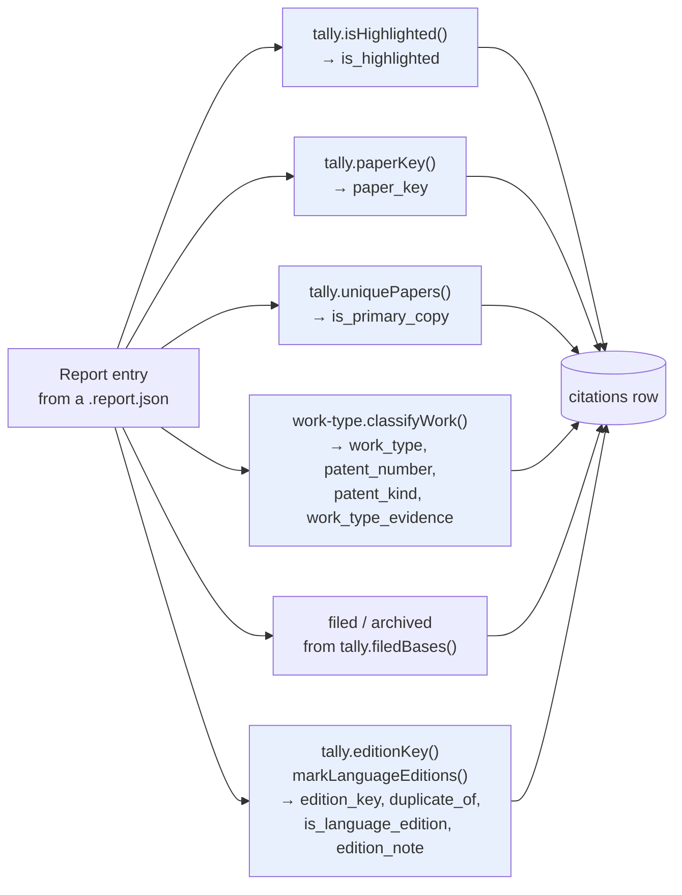
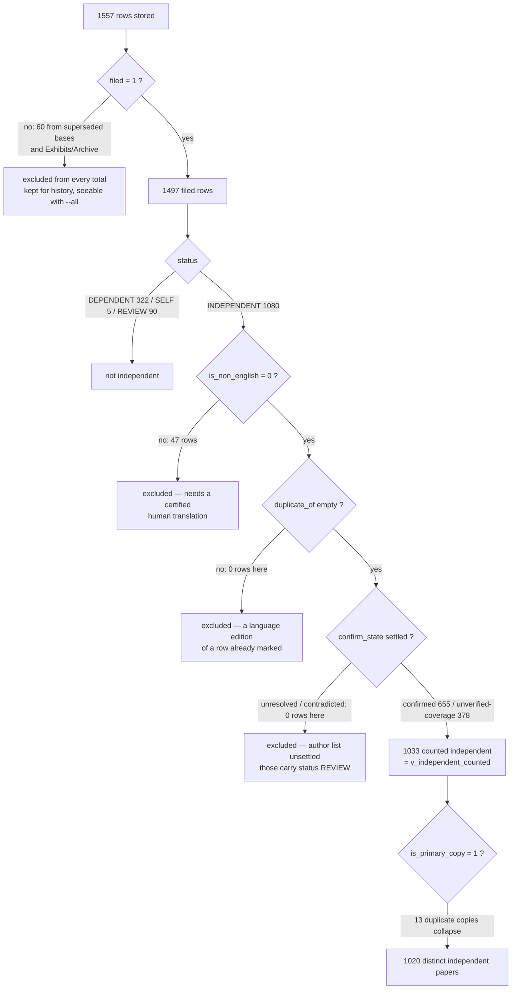
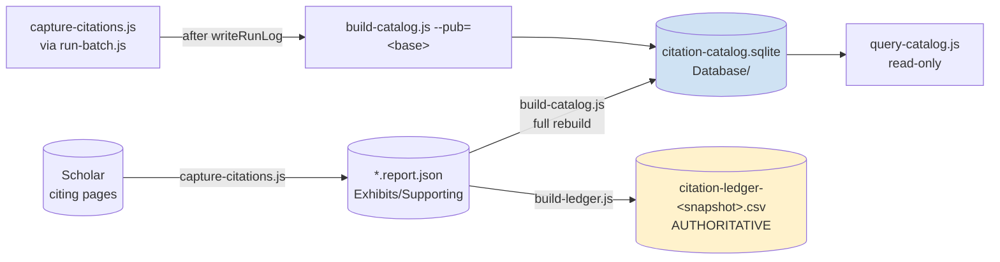

# Citation Catalog — Database Schema

**File:** `Database/citation-catalog.sqlite`
**Engine:** SQLite 3.54.0 via Node `node:sqlite` (`DatabaseSync`)
**Schema version:** 3
**Built by:** `tools/build-catalog.js` · **Read by:** `tools/query-catalog.js`
**Contents described here:** the build of 2026-11-01T21:58Z, Scholar snapshot 2026-10-31

> ## This database is a lookup aid, not the ledger
>
> Per the project instructions, **any figure quoted in the packet comes from
> `Exhibits/Supporting/citation-ledger-<snapshot>.csv`** written by
> `tools/build-ledger.js`. If a number here ever disagrees with that CSV, the CSV
> is right and this database has a bug: report it, do not quote the database.
>
> To keep that honest, `build-catalog.js` imports every counting rule from
> `tools/tally.js` rather than reimplementing one, and re-derives its own totals
> through `tally.js` at the end of every build, printing `ok`/`DIFF` per figure.
>
> **Deleting this file is always safe.** It is rebuilt from the report JSON in
> `Exhibits/Supporting/`, which remains the source of truth. That is also why it
> lives in `Database/` and not in `Exhibits/` — the Exhibits folder is the
> evidence packet that gets reviewed and filed, and a generated binary rewritten
> on every run does not belong in it.

---

## 1. Object inventory

| Type | Name | Rows | Purpose |
|---|---|---:|---|
| table | `meta` | 9 | Snapshot identity, build time, and the role warning |
| table | `publications` | 48 | The **cited** side — the PI's own papers |
| table | `citations` | 1557 | The **citing** side — one row per Scholar result (1497 filed) |
| virtual | `citations_fts` | — | FTS5 index over title, authors, snippet |
| view | `v_patents` | 15 | Citing patents and applications, kept separate from articles |
| view | `v_independent_counted` | 1033 | The rows the ledger counts as independent |
| view | `v_non_english` | 58 | Entries the language screen holds back, with the reason (52 filed, 44 of them withheld from the count) |
| view | `v_language_editions` | 6 | One article shown in two languages within a citing list |
| view | `v_pub_stats` | 48 | Per-publication rollup |
| index | `idx_citations_cites_id` | — | join to `publications` |
| index | `idx_citations_status` | — | filter by decision |
| index | `idx_citations_work_type` | — | filter article vs patent |
| index | `idx_citations_confirm` | — | filter corroboration state |
| index | `idx_citations_filed` | — | the filed-only default on every query |
| index | `idx_citations_patent` | — | lookup by publication number |
| index | `idx_citations_edition` | — | group language editions of the same article |
| index | `idx_citations_non_english` | — | separate non-English rows for statistics |
| trigger | `citations_ai` / `_ad` / `_au` | — | keep `citations_fts` in step |

Row counts above are the 2026-10-31 build. They change with every capture; the
authoritative figures are always in the ledger CSV.

---

## 2. Relationship diagram

```mermaid
erDiagram
    publications ||--o{ citations : "cites_id — cited by"

    publications {
        TEXT    cites_id PK "Scholar cites= id, or synthetic base:name"
        TEXT    title "the PI's paper title"
        TEXT    authors "full author list from the profile"
        TEXT    venue
        TEXT    year
        INTEGER cited_by_at_snapshot "count Scholar showed on 2026-10-29"
        TEXT    paper_url "profile view_citation url"
        TEXT    cites_url "the citing-articles url"
        TEXT    exhibit_base "report and PDF base name"
        INTEGER filed "1 = exhibit PDF currently in Exhibits/PDFs"
        INTEGER in_snapshot "1 = present in the publication list"
        TEXT    status "captured | not-started | no-citations-shown"
        INTEGER pages_expected "ceil(cited_by / 10)"
        INTEGER pages_captured
        INTEGER pages_complete
        TEXT    snapshot_date
    }

    citations {
        INTEGER id PK "rowid"
        TEXT    cites_id FK "which PI paper is cited"
        TEXT    base "capture base name"
        INTEGER page "citing-list page number"
        INTEGER row_index "position on that page"
        TEXT    cid "Scholar result id"
        TEXT    title "citing paper title"
        TEXT    raw_title "title as Scholar marked it up"
        TEXT    authors "Scholar snippet line, venue included"
        TEXT    authors_used "the list independence was judged from"
        TEXT    author_source "scholar-list | scholar+pubmed | ..."
        INTEGER truncated "Scholar elided the author list"
        TEXT    link
        TEXT    snippet
        TEXT    doi "derived — tally.doiOf(link), else the external record"
        TEXT    edition_key "derived — DOI article id + author signature"
        TEXT    duplicate_of "cid of the copy this row stands for, else empty"
        INTEGER is_language_edition "derived — 0 for the copy that stands"
        INTEGER is_edition_primary "derived — 1 for the copy that stands"
        TEXT    edition_note "derived — plain-language explanation"
        TEXT    status "INDEPENDENT | DEPENDENT | SELF ... | REVIEW"
        TEXT    confirm_state "confirmed | unverified-coverage | ..."
        TEXT    corroboration
        TEXT    corroboration_note
        TEXT    language_flag "empty, or why it looks non-English"
        INTEGER is_non_english "derived — 1 when language_flag is set"
        TEXT    non_english_reason "derived — same text as language_flag"
        INTEGER is_countable_independent "derived — tally.isHighlighted"
        INTEGER withheld_for_language "derived — would count but for language"
        INTEGER needs_attention
        TEXT    attention_reason
        TEXT    resolution
        TEXT    external_source
        TEXT    external_url
        TEXT    external_title
        TEXT    external_authors
        REAL    external_similarity
        TEXT    matched_authors "JSON array"
        TEXT    matched_pi "JSON array"
        TEXT    matched_former_pi "JSON array"
        TEXT    full_authors "JSON array"
        TEXT    pubmed_near_miss "JSON object or NULL"
        TEXT    openalex_near_miss "JSON object or NULL"
        INTEGER is_highlighted "derived — tally.isHighlighted"
        TEXT    paper_key "derived — tally.paperKey, dedupe identity"
        INTEGER is_primary_copy "derived — the copy a distinct-paper count uses"
        TEXT    work_type "derived — article | patent | patent-application | unknown"
        TEXT    patent_number "derived"
        TEXT    patent_kind "derived — A1 A2 B1 B2"
        TEXT    work_type_evidence "derived — why"
        INTEGER filed "denormalised from publications"
        INTEGER archived "row came from Exhibits/Archive"
        TEXT    snapshot "capture timestamp of its page"
        TEXT    report_file "the .report.json it came from"
    }

    meta {
        TEXT key PK
        TEXT value
    }
```



**No `FOREIGN KEY` clause is declared.** The `publications` → `citations` link is
logical, on `cites_id`. This is deliberate: a full rebuild deletes and rewrites
both tables from the same source in one transaction, so an enforced constraint
would add nothing, and it would break the single-publication upsert path, which
can legitimately receive citation rows before its parent row exists.

---

## 3. Full DDL

This is the schema as created, taken from `tools/build-catalog.js`.

### 3.1 `meta`

```sql
PRAGMA journal_mode = WAL;

CREATE TABLE meta (
  key   TEXT PRIMARY KEY,
  value TEXT NOT NULL
);
```

Keys written on a full build:

| Key | Example value | Meaning |
|---|---|---|
| `schema_version` | `3` | Builder refuses an upsert into a mismatched DB |
| `built_at` | `2026-11-01T21:58:38.212Z` | Full rebuild time |
| `snapshot_date` | `2026-10-31` | The Scholar snapshot every count ties to |
| `snapshot_source` | `https://scholar.google.com/citations?hl=en&user=dNLaKGAAAAAJ` | Profile the list came from |
| `publication_list_file` | `Exhibits/Supporting/publications-list-2026-10-31.json` | The dated snapshot file |
| `report_file_count` | `175` | Report JSON files read, filed or not |
| `publications_total` | `48` | Publications in the snapshot |
| `filed_rule` | `citations.filed = 1 means the exhibit PDF is currently in Exhibits/PDFs (Archive excluded).` | Definition of "filed" |
| `role` | `LOOKUP AID ONLY. Authoritative figures come from citation-ledger-<snapshot>.csv ...` | Travels with the file, so anyone opening it directly is told |

`--pub=<base>` additionally writes `last_upsert_base` and `last_upsert_at`.

### 3.2 `publications`

```sql
-- One row per publication in the Scholar snapshot, plus any captured
-- publication that is not in the list. cites_id is the natural key; a capture
-- whose cites url could not be resolved gets a synthetic key built from its
-- base name so it still has somewhere to hang its rows.
CREATE TABLE publications (
  cites_id             TEXT PRIMARY KEY,
  title                TEXT NOT NULL DEFAULT '',
  authors              TEXT NOT NULL DEFAULT '',
  venue                TEXT NOT NULL DEFAULT '',
  year                 TEXT NOT NULL DEFAULT '',
  cited_by_at_snapshot INTEGER NOT NULL DEFAULT 0,
  paper_url            TEXT NOT NULL DEFAULT '',
  cites_url            TEXT NOT NULL DEFAULT '',
  exhibit_base         TEXT NOT NULL DEFAULT '',
  filed                INTEGER NOT NULL DEFAULT 0,
  in_snapshot          INTEGER NOT NULL DEFAULT 0,
  status               TEXT NOT NULL DEFAULT '',
  pages_expected       INTEGER NOT NULL DEFAULT 0,
  pages_captured       INTEGER NOT NULL DEFAULT 0,
  pages_complete       INTEGER NOT NULL DEFAULT 0,
  snapshot_date        TEXT NOT NULL DEFAULT ''
);
```

Current distribution of `status`:

| status | rows | Meaning |
|---|---:|---|
| `captured` | 41 | Exhibit PDFs are filed |
| `no-citations-shown` | 7 | Scholar shows no count; needs no exhibit |

The 48 publications carry 168 filed citing pages between them. A publication that
Scholar shows no count for is not a gap: there is nothing to capture, and the
ledger reports it as needing no exhibit rather than as missing.

### 3.3 `citations`

```sql
-- One row per Google Scholar row observed on a citing-articles page. A paper
-- Scholar lists twice appears twice here, which is what the exhibit shows;
-- is_primary_copy marks the copy a distinct-paper count should use.
CREATE TABLE citations (
  id                  INTEGER PRIMARY KEY,
  cites_id            TEXT NOT NULL,
  base                TEXT NOT NULL,
  page                INTEGER NOT NULL DEFAULT 1,
  row_index           INTEGER,
  cid                 TEXT NOT NULL DEFAULT '',
  title               TEXT NOT NULL DEFAULT '',
  raw_title           TEXT NOT NULL DEFAULT '',
  authors             TEXT NOT NULL DEFAULT '',
  authors_used        TEXT NOT NULL DEFAULT '',
  author_source       TEXT NOT NULL DEFAULT '',
  truncated           INTEGER NOT NULL DEFAULT 0,
  link                TEXT NOT NULL DEFAULT '',
  snippet             TEXT NOT NULL DEFAULT '',
  doi                 TEXT NOT NULL DEFAULT '',
  edition_key         TEXT NOT NULL DEFAULT '',
  duplicate_of        TEXT NOT NULL DEFAULT '',
  is_language_edition INTEGER NOT NULL DEFAULT 0,
  is_edition_primary  INTEGER NOT NULL DEFAULT 1,
  edition_note        TEXT NOT NULL DEFAULT '',
  status              TEXT NOT NULL DEFAULT '',
  confirm_state       TEXT NOT NULL DEFAULT '',
  corroboration       TEXT NOT NULL DEFAULT '',
  corroboration_note  TEXT NOT NULL DEFAULT '',
  language_flag       TEXT NOT NULL DEFAULT '',
  is_non_english           INTEGER NOT NULL DEFAULT 0,
  non_english_reason       TEXT NOT NULL DEFAULT '',
  is_countable_independent INTEGER NOT NULL DEFAULT 0,
  withheld_for_language    INTEGER NOT NULL DEFAULT 0,
  needs_attention     INTEGER NOT NULL DEFAULT 0,
  attention_reason    TEXT NOT NULL DEFAULT '',
  resolution          TEXT NOT NULL DEFAULT '',
  external_source     TEXT NOT NULL DEFAULT '',
  external_url        TEXT NOT NULL DEFAULT '',
  external_title      TEXT NOT NULL DEFAULT '',
  external_authors    TEXT NOT NULL DEFAULT '',
  external_similarity REAL,
  matched_authors     TEXT NOT NULL DEFAULT '[]',
  matched_pi          TEXT NOT NULL DEFAULT '[]',
  matched_former_pi   TEXT NOT NULL DEFAULT '[]',
  full_authors        TEXT NOT NULL DEFAULT '[]',
  pubmed_near_miss    TEXT,
  openalex_near_miss  TEXT,
  is_highlighted      INTEGER NOT NULL DEFAULT 0,
  paper_key           TEXT NOT NULL DEFAULT '',
  is_primary_copy     INTEGER NOT NULL DEFAULT 1,
  work_type           TEXT NOT NULL DEFAULT 'article',
  patent_number       TEXT NOT NULL DEFAULT '',
  patent_kind         TEXT NOT NULL DEFAULT '',
  work_type_evidence  TEXT NOT NULL DEFAULT '',
  filed               INTEGER NOT NULL DEFAULT 0,
  archived            INTEGER NOT NULL DEFAULT 0,
  snapshot            TEXT NOT NULL DEFAULT '',
  report_file         TEXT NOT NULL DEFAULT ''
);

CREATE INDEX idx_citations_cites_id ON citations(cites_id);
CREATE INDEX idx_citations_status ON citations(status);
CREATE INDEX idx_citations_work_type ON citations(work_type);
CREATE INDEX idx_citations_confirm ON citations(confirm_state);
CREATE INDEX idx_citations_filed ON citations(filed);
CREATE INDEX idx_citations_patent ON citations(patent_number);
CREATE INDEX idx_citations_edition ON citations(edition_key);
```

#### Column groups

**Position — where this row was seen.** `(cites_id, base, page, row_index)`
reproduces the exhibit exactly. `cid` is Scholar's own result id.

**What Scholar showed.** `title`, `raw_title` (its markup), `authors` — the
snippet line, which is where Scholar prints the venue, e.g.
`K Hong, DC Drummond, D Kirpotin - US Patent 11,052,079, 2021 - Google Patents` —
plus `snippet` and `link`.

**The author evidence.** `authors_used` is the list independence was actually
judged from; `author_source` says where it came from.

| `author_source` | Meaning |
|---|---|
| `scholar-list` | The snippet list, complete enough to decide |
| `scholar-cite-bibtex` | Scholar truncated it; the full list came from the Cite popup's BibTeX record |
| `scholar+pubmed` | Snippet plus an external PubMed list used for corroboration |
| `scholar+openalex` | Same, via OpenAlex |

`truncated` records that Scholar elided the list with an ellipsis.
`matched_authors`, `matched_pi`, `matched_former_pi`, `full_authors` are JSON
arrays — store as text, query with `json_each()`. They name *which* authors
caused a match, so a decision can be re-checked without re-browsing.

**The decision.** `status` is the classification; `is_highlighted` is whether it
is counted. These are not the same thing, and that gap is the point.

| `status` | rows (filed) | Meaning |
|---|---:|---|
| `INDEPENDENT` | 1080 | Shares no author with the cited paper |
| `DEPENDENT` | 322 | Shares an author |
| `REVIEW` | 90 | Unresolved — never counted either way |
| `SELF (PI)` | 0 | Lists RD Cummings |
| `SELF (FORMER PI)` | 5 | Lists UR Desai |

**Corroboration.** Google Scholar is primary; an external record never *promotes*
a row, it only confirms or casts doubt.

| `confirm_state` | rows (filed) | Meaning |
|---|---:|---|
| `confirmed` | 676 | PubMed or OpenAlex published a complete list with no overlap |
| `unverified-coverage` | 414 | Not indexed externally, Scholar's own list complete — counted, and flagged for a spot-check. Typical of patents, theses, preprints |
| `unresolved` | 74 | Not indexed and Scholar's list truncated — not counted |
| `contradicted` | 6 | External list shows an overlap — pulled back to REVIEW |
| *(empty)* | 327 | Not cross-checked, because only independent candidates are |

The empty `confirm_state` rows are exactly the 322 `DEPENDENT` plus the 5
`SELF (FORMER PI)`: a row already rejected on Scholar's own list is not worth an
external request. Of the cross-checked rows, 10 `confirmed` and all 6
`contradicted` sit under `REVIEW` — the first because a surname collided without
initials to settle it, the second because the external list showed an overlap.

**Language.** `language_flag` is empty or says why the row looks non-English
(`non-latin script (title)`, `non-latin script (snippet)`,
`accented letters: ś ą ę`, `possible non-English (aux, et, des, pour)`). Per the
guide a citation not listed in English needs a certified human translation and
affidavit before it may be highlighted, so a flag excludes it. **44** filed rows
carry a flag and would otherwise have counted; **52** filed rows are flagged in
total, and **zero** flagged rows are highlighted.

The user decided on 2026-11-01 **not to obtain translations**, which is the
guide's second path: leave non-English entries unhighlighted and report an
adjusted total and percentage based solely on English citations. Four derived
columns make that separable without re-reading any rule:

| Column | Meaning |
|---|---|
| `is_non_english` | 1 when the language screen flagged the entry |
| `non_english_reason` | the same text as `language_flag`, named for querying |
| `is_countable_independent` | 1 exactly when `tally.isHighlighted` counts the row — the exhibit mark and this column call the same function |
| `withheld_for_language` | 1 when the row would count but for the language flag alone, ie what a certified translation would recover |

`node tools/query-catalog.js nonenglish` lists them; `v_non_english` backs it.
The adjusted figures themselves are quoted from the ledger, not here —
`english_independent_records` over `english_citation_records`, and the same pair
on the distinct-paper basis. Note the denominator: the guide says to divide
English independent citations by the English citations indexed on the profile,
and Google Scholar publishes no English-only profile total, so the denominator
used is the English rows on the citing lists. That is stated in the ledger's own
`note` field rather than left implied.

**Language editions — one article, two languages.** A publisher can serve the
same article in two languages and Scholar lists both rows in the same citing
list, each with its own result id and its own DOI. Wiley does this for
Angewandte Chemie: `10.1002/anie.7795967` is the English article and
`10.1002/ange.7795967` the German one, titled *Untersuchung von Anti-Glykan-
Antikörpern* to the English *Using Synthetic Glycans to Investigate Anti-Glycan
Antibodies*. They are one citing paper, not two, and the exhibit must mark it once.

The language screen alone does not catch this — a translation can carry an
English title. So the rule keys on the DOI instead, and only on the part of the
DOI that identifies the article: `doiArticleId()` takes the last dotted segment
(`7795967`), discarding the journal code that differs between the two editions.
`edition_key` combines that id with an author signature, and is written whenever
both are known — that is provenance, not a duplicate claim.

| Column | Meaning |
|---|---|
| `doi` | Extracted from the result link, else from the external record. Empty when neither publishes one |
| `edition_key` | `doi:<prefix>:<article id>:<author signature>`; empty when it cannot be proven |
| `duplicate_of` | The `cid` of the copy this row stands for; empty for the copy that stands |
| `is_language_edition` | `1` for a held-back edition, `0` for the copy that stands for the work |
| `is_edition_primary` | `1` for the copy that stands — the mirror of the above |
| `edition_note` | Plain-language explanation, naming the copy and page it duplicates |

A family exists only where one `edition_key` carries **two different DOIs**. Two
rows sharing the identical DOI are the ordinary duplicate-version case that
`paper_key` already merges, and are deliberately excluded — `markLanguageEditions`
refuses to claim an edition on that evidence. The rule is conservative by
design in three further ways: it needs an author signature as well as a DOI, so
two unrelated works reusing an article id do not merge; it needs an article id of
at least five characters containing a digit, so a journal-level DOI such as
`10.1002/anie` matches nothing in particular; and it never suppresses a lone row.

The copy that stands is chosen by `editionPreference()` — a copy already
highlighted on a printed page wins, then one the language screen accepts, then
the more complete author list — and the choice does not depend on which page is
processed first. A held-back edition is **never highlighted**, in the PDF or in
the counts: `tally.isHighlighted()` refuses any row carrying a `duplicate_of`,
and `isHighlightCandidate()` is what still lets it be corroborated and recorded.

458 rows carry an `edition_key` (443 of them filed) and 3 are held back as an
edition, across 3 citing lists — one article, appearing in each of three citing
lists. **No counted figure changes**, because in every case the held-back copy was
already excluded by `language_flag`; the columns document what would otherwise look
like a citation Scholar invented. See `v_language_editions` and
`node tools/query-catalog.js editions`.

The English/Chinese pair on the haemoglobin microarray work is *not* caught, and
that is intended: the Chinese row publishes no DOI, so nothing can be proven. It
is excluded from the counted totals by its language flag, which is the correct
answer for it.

**Work type — article or patent.** Derived by `tools/work-type.js`, never stored
raw. Only positive evidence counts: a patent-server link, or a venue string
naming a patent document. Titles and snippets are **not** scanned, so a journal
article *about* patents is not misfiled.

| `work_type` | rows (filed) | Counted | Evidence recorded |
|---|---:|---:|---|
| `article` | 1475 | 1020 | *(none)* |
| `patent` | 10 | 6 | `link host patents.google.com; Scholar venue text names a patent document` |
| `patent-application` | 5 | 2 | same |
| `unknown` | 7 | 5 | `venue text mentions "patents" but shows no patent document` |

`unknown` is a deliberate third answer, not a bug. Each of the seven rows publishes
in a journal whose *name* contains "patents" — several sit on the citing list of
*An update on recent patents on thrombin inhibitors* — so the venue mentions
patents without being one. They are counted as citations either way; the flag only
stops them being filed as patents, and surfaces them under `review`. Guessing would
either inflate industry uptake or bury the doubt.

Patents are never folded into the article total. They are a separate view over
the same rows.

**Provenance.** `filed` is denormalised from `publications` so a query filters
without a join. `archived` marks a row read from `Exhibits/Archive`. `snapshot`
is the capture timestamp of that page; `report_file` names the exact JSON.



Every derived column is computed by a shared module, never inline. That is what
keeps this database and the ledger from ever meaning different things by the same
word.

### 3.4 `citations_fts` and its triggers

```sql
-- Full-text over the three fields a reviewer searches. External content keeps
-- one copy of the text in the citations table; the triggers below mean the index
-- cannot fall out of step with the table, whichever path writes the rows.
CREATE VIRTUAL TABLE citations_fts USING fts5(
  title,
  authors_used,
  snippet,
  content='citations',
  content_rowid='id',
  tokenize='unicode61 remove_diacritics 2'
);

CREATE TRIGGER citations_ai AFTER INSERT ON citations BEGIN
  INSERT INTO citations_fts(rowid, title, authors_used, snippet)
  VALUES (new.id, new.title, new.authors_used, new.snippet);
END;

CREATE TRIGGER citations_ad AFTER DELETE ON citations BEGIN
  INSERT INTO citations_fts(citations_fts, rowid, title, authors_used, snippet)
  VALUES ('delete', old.id, old.title, old.authors_used, old.snippet);
END;

CREATE TRIGGER citations_au AFTER UPDATE ON citations BEGIN
  INSERT INTO citations_fts(citations_fts, rowid, title, authors_used, snippet)
  VALUES ('delete', old.id, old.title, old.authors_used, old.snippet);
  INSERT INTO citations_fts(rowid, title, authors_used, snippet)
  VALUES (new.id, new.title, new.authors_used, new.snippet);
END;
```

This is an **external-content** FTS5 table: it stores an index, not a second copy
of the text, and reads the row back out of `citations`. `unicode61
remove_diacritics 2` means a search for `galectin` finds `galectină`, and accented
author names are found without the accents.

### 3.5 Views

```sql
-- Citing patents, separable from the article citations by design. Both the
-- granted form and an application publication count as the patent family; a
-- work_type of 'unknown' (a venue that merely mentions patents) is excluded
-- here and surfaces under the review query instead.
CREATE VIEW v_patents AS
SELECT
  c.patent_number,
  c.patent_kind,
  CASE c.work_type WHEN 'patent-application' THEN 'application' ELSE 'granted' END AS kind,
  c.title,
  -- authors_used is the list independence was judged from (the Cite-popup
  -- record when Scholar truncated the snippet); the raw authors field still
  -- carries the venue text Scholar printed after it.
  COALESCE(NULLIF(c.authors_used, ''), c.authors) AS authors,
  c.link,
  c.status,
  c.confirm_state,
  c.is_highlighted,
  c.filed,
  c.work_type_evidence AS evidence,
  p.title AS cited_title,
  p.cites_id,
  c.base,
  c.page,
  c.row_index,
  c.id
FROM citations c
LEFT JOIN publications p ON p.cites_id = c.cites_id
WHERE c.work_type IN ('patent', 'patent-application');
```

```sql
-- The rows the ledger counts as independent: filed exhibits only, and
-- is_highlighted comes from tally.isHighlighted, so it already excludes a
-- non-English entry or one whose author list no source has settled.
CREATE VIEW v_independent_counted AS
SELECT c.*
FROM citations c
WHERE c.is_highlighted = 1 AND c.filed = 1;
```

```sql
-- Every entry the language screen holds back, with the reason and whether it
-- would otherwise have counted. This is the separation the adjusted
-- English-only figures are built from, and the list a certified translation
-- would have to cover to reclaim them.
CREATE VIEW v_non_english AS
SELECT
  c.cites_id,
  p.title AS cited_work,
  c.cid,
  c.title,
  COALESCE(NULLIF(c.authors_used, ''), c.authors) AS authors,
  c.link,
  c.language_flag AS reason,
  c.status,
  c.confirm_state,
  c.is_highlighted,
  c.withheld_for_language AS would_count,
  CASE WHEN c.duplicate_of <> '' THEN 1 ELSE 0 END AS language_edition,
  c.work_type,
  c.base,
  c.page,
  c.row_index,
  c.filed,
  c.id
FROM citations c
LEFT JOIN publications p ON p.cites_id = c.cites_id
WHERE c.is_non_english = 1
ORDER BY c.withheld_for_language DESC, c.cites_id, c.page, c.row_index;
```

```sql
-- Language editions of one another within a single citing list. A publisher can
-- serve the same article in two languages and Scholar lists both rows, each
-- with its own cid and its own DOI, so the exhibit shows the article twice and
-- marks it once.
--
-- edition_key is recorded on every row whose work can be proven from a DOI plus
-- an author list, which is most rows -- that is provenance, not a duplicate
-- claim. A family exists only where one key carries TWO different DOIs, so that
-- is what this view filters on. Two rows sharing one DOI exactly are the ordinary
-- duplicate-version case that paper_key already merges, and are excluded here.
--
-- Within a family, is_language_edition = 0 is the copy that stands for the work
-- and is the one a reader should cite; is_highlighted shows what the exhibit
-- marks, which is never the edition.
--
-- This view documents the relationship and changes no count: the non-English
-- copy is already excluded from the independent total by language_flag.
CREATE VIEW v_language_editions AS
SELECT
  c.cites_id,
  p.title AS cited_work,
  c.edition_key,
  c.is_language_edition,
  c.cid,
  c.page,
  c.row_index,
  c.doi,
  c.duplicate_of,
  c.title,
  c.language_flag,
  c.status,
  c.is_highlighted,
  c.edition_note,
  c.base,
  c.filed
FROM citations c
LEFT JOIN publications p ON p.cites_id = c.cites_id
WHERE EXISTS (
  SELECT 1 FROM citations f
  WHERE f.cites_id = c.cites_id AND f.edition_key = c.edition_key
    AND f.edition_key <> ''
  GROUP BY f.cites_id, f.edition_key
  HAVING COUNT(DISTINCT f.doi) > 1
)
ORDER BY c.cites_id, c.edition_key, c.is_language_edition DESC, c.page;
```

```sql
-- Per-publication rollup. Totals are filed-only; join on filed = 1 rows so an
-- archived capture cannot add to a count.
CREATE VIEW v_pub_stats AS
SELECT
  p.cites_id,
  p.title,
  p.venue,
  p.year,
  p.cited_by_at_snapshot,
  p.exhibit_base,
  p.filed,
  p.status,
  p.pages_expected,
  p.pages_captured,
  p.pages_complete,
  SUM(CASE WHEN c.filed = 1 THEN 1 ELSE 0 END) AS records,
  SUM(CASE WHEN c.filed = 1 AND c.is_highlighted = 1 THEN 1 ELSE 0 END) AS independent,
  SUM(CASE WHEN c.filed = 1 AND c.is_highlighted = 1 AND c.confirm_state = 'confirmed' THEN 1 ELSE 0 END) AS independent_confirmed,
  SUM(CASE WHEN c.filed = 1 AND c.is_highlighted = 1 AND c.confirm_state = 'unverified-coverage' THEN 1 ELSE 0 END) AS independent_coverage,
  SUM(CASE WHEN c.filed = 1 AND c.status = 'DEPENDENT' THEN 1 ELSE 0 END) AS dependent,
  SUM(CASE WHEN c.filed = 1 AND c.status = 'SELF (PI)' THEN 1 ELSE 0 END) AS self_pi,
  SUM(CASE WHEN c.filed = 1 AND c.status = 'SELF (FORMER PI)' THEN 1 ELSE 0 END) AS self_former_pi,
  SUM(CASE WHEN c.filed = 1 AND c.status = 'REVIEW' THEN 1 ELSE 0 END) AS review,
  SUM(CASE WHEN c.filed = 1 AND c.language_flag <> '' THEN 1 ELSE 0 END) AS non_english,
  SUM(CASE WHEN c.filed = 1 AND c.withheld_for_language = 1 THEN 1 ELSE 0 END) AS non_english_withheld,
  SUM(CASE WHEN c.filed = 1 AND c.is_non_english = 0 THEN 1 ELSE 0 END) AS english_records,
  SUM(CASE WHEN c.filed = 1 AND c.is_non_english = 0 AND c.is_highlighted = 1 THEN 1 ELSE 0 END) AS english_independent,
  SUM(CASE WHEN c.filed = 1 AND c.work_type IN ('patent','patent-application') THEN 1 ELSE 0 END) AS patents,
  SUM(CASE WHEN c.filed = 1 AND (c.needs_attention = 1 OR c.status = 'REVIEW') THEN 1 ELSE 0 END) AS needs_attention
FROM publications p
LEFT JOIN citations c ON c.cites_id = p.cites_id
GROUP BY p.cites_id;
```

---

## 4. What is stored versus what is counted

The most common mistake when reading this database is treating a row count as a
filing figure. Four separate filters sit between them.



The funnel is exact: 1080 - 47 - 0 - 0 = 1033, and 1033 - 13 = 1020. The last two
branches are empty by construction — every row whose author list is unsettled is
classified `REVIEW` rather than `INDEPENDENT`, and all three language editions in
the corpus are also non-English, so they are already excluded one step earlier.
`withheld_for_language` marks 44 of the 47: those are the rows a certified
translation would bring back.

    style H fill:#d9ead3
    style U fill:#d9ead3
    style X fill:#f4cccc
    style Z fill:#f4cccc
    style Z2 fill:#f4cccc
    style Z3 fill:#f4cccc
```

Two row counts are reported on purpose:

- **rows** — what the exhibit pages show, since Scholar displays every copy
- **distinct papers** — after Scholar's duplicate versions collapse, which is the
  figure to quote when saying *how many papers cite this work*

`is_primary_copy` marks the surviving copy, chosen by `tally.uniquePapers()` —
the complete author list wins, an external confirmation breaks a tie. Currently 6
filed rows are non-primary. A language edition is a separate exclusion, one step
earlier: it is not marked and not counted at all, whether or not it is the
primary copy, because it is the same citing paper as the row it duplicates.

---

## 5. Lifecycle



- **Full rebuild** deletes and rewrites everything in one transaction, and removes
  the `-wal` / `-shm` sidecars first so a stale log cannot be replayed into the
  new file. It is idempotent in data: running it twice over the same reports
  produces the same rows, and only `built_at` differs.
- **`--pub=<base>`** replaces one publication's rows only. If no report file
  exists for that base — which is exactly what a run blocked at a verification
  wall produces — it writes nothing at all, so a failed capture cannot empty a
  good publication. This was verified on 2026-10-31: a blocked attempt left the
  database at its previous totals.
- **Schema guard.** An upsert into a database whose `schema_version` differs from
  the builder's is refused with exit code 3 rather than partially written.
- **`query-catalog.js` opens read-only.** The engine itself rejects a write; the
  `sql` subcommand additionally refuses anything that is not a single `SELECT` or
  `WITH`, including stacked statements and any write or schema keyword.

---

## 6. Using it

```
node tools/build-catalog.js                 full rebuild, prints reconciliation
node tools/build-catalog.js --pub=<base>    upsert one publication
node tools/build-catalog.js --check         report what it would write, touch nothing

node tools/query-catalog.js patents         citing patents
node tools/query-catalog.js stats           totals, overall and per publication
node tools/query-catalog.js search <terms>  full-text over title, authors, snippet
node tools/query-catalog.js pub <text|id>   everything citing one publication
node tools/query-catalog.js review          rows needing attention
node tools/query-catalog.js editions        one article listed in two languages
node tools/query-catalog.js nonenglish      entries held back for language
node tools/query-catalog.js sql "SELECT…"   ad-hoc SELECT only
node tools/query-catalog.js tables          object inventory
```

Global switches: `--csv` for spreadsheet output, `--all` to widen to unfiled and
archived captures, `--limit=N` to raise the default cap of 40.

Default totals are filed-only, which is what makes `stats` reproduce the ledger.
`--all` is a history view and its numbers are not filing figures.

---

## 7. Deliberate design choices

| Choice | Reason |
|---|---|
| Lives in `Database/`, not `Exhibits/` | Exhibits is the evidence packet; a regenerated binary does not belong in it |
| Not the ledger | One authoritative source for a quoted figure; the CSV is it |
| Counts imported from `tally.js` | Prevents the drift that previously made three reports disagree about the same PDF |
| Superseded rows kept, flagged `filed = 0` | History is worth querying; the flag is what keeps it out of totals |
| `role` stored in `meta` | Someone opening the file directly, without this document, is still told |
| No enforced foreign keys | Rebuild rewrites both tables together; a constraint would break the upsert path |
| `unknown` work type | A venue that merely mentions patents is neither guessed a patent nor silently filed as an article |
| Editions keyed on the DOI article id, not the title | Two language editions have different titles and different DOIs, so a title comparison cannot see them; the article id is the one part of the DOI both share |
| Editions documented, never re-counted | The held-back copy was already excluded by `language_flag`, so recording it changes no filed figure while explaining a row that would otherwise look invented |
| No edition claim without a DOI **and** an author list | A translation with no DOI (the Chinese haemoglobin row) stays a language question, not a duplicate claim. Guessing would merge two different papers |
| FTS triggers rather than a rebuild step | The index cannot silently fall out of step with the table |
| Reconciliation printed on every build | A disagreement with the ledger rule surfaces instead of hiding |
