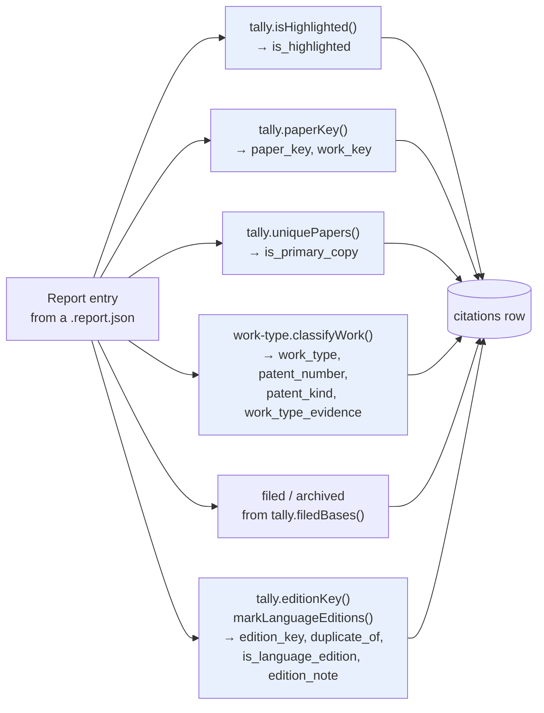
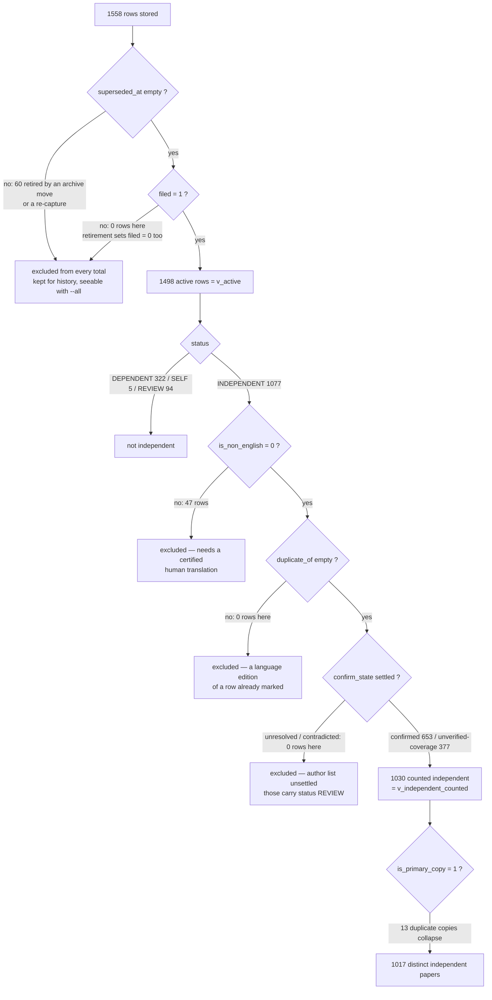
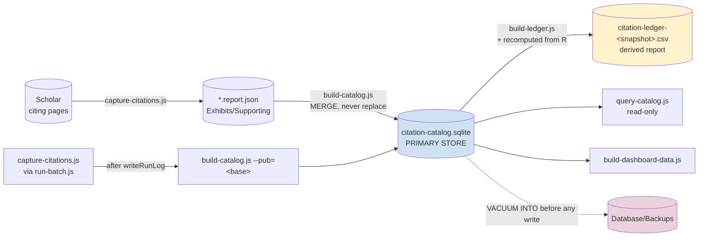

# Citation Catalog — Database Schema

**File:** `Database/citation-catalog.sqlite`
**Engine:** SQLite 3.54.0 via Node `node:sqlite` (`DatabaseSync`)
**Schema version:** 4
**Built by:** `tools/build-catalog.js` · **Read by:** `tools/query-catalog.js`
**Contents described here:** the merge of 2026-11-02T14:45Z, Scholar snapshot 2026-11-02

> ## This database is the primary store
>
> It is the durable copy of the independent-citation record. **Do not delete it.**
> `row_uid` values minted here are quoted in review sheets and to a reviewer, and
> a quoted identifier is only worth anything if it still means the same row next
> month — which it cannot if the file is rebuilt from scratch.
>
> `Exhibits/Supporting/citation-ledger-<snapshot>.csv`, written by
> `tools/build-ledger.js`, is a **derived report** of these rows and is what the
> packet quotes from, so that per-article and global statistics come from one
> place. It now reads its citation rows from here and recomputes them
> independently from the report JSON as a cross-check.
>
> **If the store and the report-derived figures disagree, neither is right by
> rule.** That disagreement is a defect to investigate, and no figure may be
> quoted for the packet until it is resolved. Both tools exit non-zero rather
> than pick a winner.
>
> To keep the two comparable, `build-catalog.js` imports every counting rule from
> `tools/tally.js` rather than reimplementing one, and re-derives the totals
> straight from the reports at the end of every build, printing `ok`/`DIFF` per
> figure.
>
> **Backups.** A verified `VACUUM INTO` snapshot is taken into
> `Database/Backups/` before any structural change or any merge that writes, and
> the snapshot is reopened and counted before the run is called a success. The
> snapshots are the recovery path if a merge ever goes wrong, so they are kept
> outside `Exhibits/` and never deleted by a build. They are **not** committed to
> git: each is several megabytes, they are written on nearly every run, and
> committing them would add tens of megabytes of near-identical binaries to
> history for files that are a safety net rather than a deliverable. The tracked
> copy of the data is `Database/citation-catalog.sqlite` itself. If a snapshot
> needs to survive long-term — before a rule change, say — copy it somewhere
> tracked or outside the repository deliberately, rather than committing the
> folder.
>
> It still lives in `Database/` and not in `Exhibits/` — the Exhibits folder is
> the evidence packet that gets reviewed and filed, and a database is not
> evidence.

---

## 1. Object inventory

| Type | Name | Rows | Purpose |
|---|---|---:|---|
| table | `meta` | 11 | Snapshot identity, build time, and the role and identity rules |
| table | `publications` | 48 | The **cited** side — the PI's own papers |
| table | `citations` | 1558 | The **citing** side — one row per Scholar result (1498 active, 60 retired) |
| virtual | `citations_fts` | — | FTS5 index over title, authors, snippet |
| view | `v_active` | 1498 | The rows that are the current record: filed and not superseded |
| view | `v_review` | 94 | The unresolved citations, bucketed for a decision sheet |
| view | `v_patents` | 15 | Citing patents and applications, kept separate from articles |
| view | `v_independent_counted` | 1030 | The rows the ledger counts as independent |
| view | `v_non_english` | 58 | Entries the language screen holds back, with the reason (52 active, 44 of them withheld from the count) |
| view | `v_language_editions` | 6 | One article shown in two languages within a citing list |
| view | `v_pub_stats` | 48 | Per-publication rollup |
| index | `idx_citations_natural_key` | — | **UNIQUE** `(base, page, row_index)` — the key the merge upserts on |
| index | `idx_citations_row_uid` | — | lookup by the identifier a reviewer quotes |
| index | `idx_citations_work_key` | — | group copies of one citing work within a citing list |
| index | `idx_citations_superseded` | — | separate retired history from the active record |
| index | `idx_citations_cites_id` | — | join to `publications` |
| index | `idx_citations_status` | — | filter by decision |
| index | `idx_citations_work_type` | — | filter article vs patent |
| index | `idx_citations_confirm` | — | filter corroboration state |
| index | `idx_citations_filed` | — | the filed-only default on every query |
| index | `idx_citations_patent` | — | lookup by publication number |
| index | `idx_citations_edition` | — | group language editions of the same article |
| index | `idx_citations_non_english` | — | separate non-English rows for statistics |
| trigger | `citations_ai` / `_ad` / `_au` | — | keep `citations_fts` in step |

Row counts above are the 2026-11-02 merge. They change with every capture; the
figures quoted in the packet are always in the dated ledger CSV, which is built
from these rows.

---

## 2. Relationship diagram

```mermaid
erDiagram
    publications ||--o{ citations : "cites_id — cited by"

    publications {
        TEXT    cites_id PK "Scholar cites= id, or synthetic base:name"
        TEXT    title "the PI's paper title"
        TEXT    authors "full author list from the profile"
        TEXT    venue
        TEXT    year
        INTEGER cited_by_at_snapshot "count Scholar showed on 2026-11-02"
        TEXT    paper_url "profile view_citation url"
        TEXT    cites_url "the citing-articles url"
        TEXT    exhibit_base "report and PDF base name"
        INTEGER filed "1 = exhibit PDF currently in Exhibits/PDFs"
        INTEGER in_snapshot "1 = present in the publication list"
        TEXT    status "captured | not-started | no-citations-shown"
        INTEGER pages_expected "ceil(cited_by / 10)"
        INTEGER pages_captured
        INTEGER pages_complete
        TEXT    snapshot_date
    }

    citations {
        TEXT    row_uid UK "cit-000123 — the identifier to quote, minted once"
        INTEGER id PK "frozen legacy alias of row_uid"
        TEXT    cites_id FK "which PI paper is cited"
        TEXT    base "capture base name"
        INTEGER page "citing-list page number"
        INTEGER row_index "position on that page"
        TEXT    cid "Scholar result id"
        TEXT    title "citing paper title"
        TEXT    raw_title "title as Scholar marked it up"
        TEXT    authors "Scholar snippet line, venue included"
        TEXT    authors_used "the list independence was judged from"
        TEXT    author_source "scholar-list | scholar+pubmed | ..."
        INTEGER truncated "Scholar elided the author list"
        TEXT    link
        TEXT    snippet
        TEXT    doi "derived — tally.doiOf(link), else the external record"
        TEXT    edition_key "derived — DOI article id + author signature"
        TEXT    duplicate_of "cid of the copy this row stands for, else empty"
        INTEGER is_language_edition "derived — 0 for the copy that stands"
        INTEGER is_edition_primary "derived — 1 for the copy that stands"
        TEXT    edition_note "derived — plain-language explanation"
        TEXT    status "INDEPENDENT | DEPENDENT | SELF ... | REVIEW"
        TEXT    confirm_state "confirmed | unverified-coverage | ..."
        TEXT    corroboration
        TEXT    corroboration_note
        TEXT    language_flag "empty, or why it looks non-English"
        INTEGER is_non_english "derived — 1 when language_flag is set"
        TEXT    non_english_reason "derived — same text as language_flag"
        INTEGER is_countable_independent "derived — tally.isHighlighted"
        INTEGER withheld_for_language "derived — would count but for language"
        INTEGER needs_attention
        TEXT    attention_reason
        TEXT    resolution
        TEXT    external_source
        TEXT    external_url
        TEXT    external_title
        TEXT    external_authors
        REAL    external_similarity
        TEXT    matched_authors "JSON array"
        TEXT    matched_pi "JSON array"
        TEXT    matched_former_pi "JSON array"
        TEXT    full_authors "JSON array"
        TEXT    pubmed_near_miss "JSON object or NULL"
        TEXT    openalex_near_miss "JSON object or NULL"
        TEXT    external_matched "JSON array — names the external record agreed on"
        INTEGER is_highlighted "derived — tally.isHighlighted"
        TEXT    paper_key "derived — tally.paperKey, dedupe identity"
        INTEGER is_primary_copy "derived — the copy a distinct-paper count uses"
        TEXT    work_key "derived — tally.paperKey, groups copies of one work"
        TEXT    work_type "derived — article | patent | patent-application | unknown"
        TEXT    patent_number "derived"
        TEXT    patent_kind "derived — A1 A2 B1 B2"
        TEXT    work_type_evidence "derived — why"
        INTEGER filed "denormalised from publications"
        INTEGER archived "row came from Exhibits/Archive"
        TEXT    snapshot "capture timestamp of its page"
        TEXT    report_file "the .report.json it came from"
        TEXT    origin_dir "folder the report was read from — provenance"
        TEXT    stands_for_row_uid "the ROW that stands for this work, when this is a copy"
        TEXT    superseded_at "date retired, empty while active"
        TEXT    replaced_by_row_uid "the ROW that took its place"
        TEXT    supersede_reason "plain-language why it was retired"
    }

    meta {
        TEXT key PK
        TEXT value
    }
```



**No `FOREIGN KEY` clause is declared.** The `publications` → `citations` link is
logical, on `cites_id`. This is deliberate: the merge writes both from the same
source in one transaction, so an enforced constraint would add nothing, and it
would break the single-publication upsert path, which can legitimately receive
citation rows before its parent row exists.

`row_uid` → `row_uid` links are also logical, not enforced: `stands_for_row_uid`
and `replaced_by_row_uid` can point at a row in a capture that has not been
merged yet, and a constraint would refuse a legitimate incremental run.

---

## 3. Full DDL

This is the schema as created, taken from `tools/build-catalog.js`.

### 3.1 `meta`

```sql
PRAGMA journal_mode = WAL;

CREATE TABLE meta (
  key   TEXT PRIMARY KEY,
  value TEXT NOT NULL
);
```

Keys written on a merge:

| Key | Example value | Meaning |
|---|---|---|
| `schema_version` | `4` | Builder migrates a mismatched DB in place rather than refusing |
| `built_at` | `2026-11-02T14:45:20.705Z` | Last write |
| `snapshot_date` | `2026-11-02` | The Scholar snapshot every count ties to |
| `snapshot_source` | `https://scholar.google.com/citations?hl=en&user=dNLaKGAAAAAJ` | Profile the list came from |
| `publication_list_file` | `Exhibits/Supporting/publications-list-2026-11-02.json` | The dated snapshot file |
| `report_file_count` | `175` | Report JSON files read, filed or not |
| `publications_total` | `48` | Publications in the snapshot |
| `filed_rule` | `citations.filed = 1 means the exhibit PDF is currently in Exhibits/PDFs (Archive excluded).` | Definition of "filed" |
| `role` | `PRIMARY DURABLE STORE ... If the two disagree, that is a defect to investigate and NO figure may be quoted for the packet until it is resolved.` | Travels with the file, so anyone opening it directly is told what it is |
| `identity_rule` | `row_uid is the identifier to quote. id is its frozen legacy alias. The natural key is (base, page, row_index) ... duplicate_of holds Scholar's cid and is NOT a row key ... stands_for_row_uid is the pointer that resolves to one row.` | The identity contract, stored next to the data it governs |

`--pub=<base>` additionally writes `last_upsert_base` and `last_upsert_at`.

### 3.2 `publications`

```sql
-- One row per publication in the Scholar snapshot, plus any captured
-- publication that is not in the list. cites_id is the natural key; a capture
-- whose cites url could not be resolved gets a synthetic key built from its
-- base name so it still has somewhere to hang its rows.
CREATE TABLE publications (
  cites_id             TEXT PRIMARY KEY,
  title                TEXT NOT NULL DEFAULT '',
  authors              TEXT NOT NULL DEFAULT '',
  venue                TEXT NOT NULL DEFAULT '',
  year                 TEXT NOT NULL DEFAULT '',
  cited_by_at_snapshot INTEGER NOT NULL DEFAULT 0,
  paper_url            TEXT NOT NULL DEFAULT '',
  cites_url            TEXT NOT NULL DEFAULT '',
  exhibit_base         TEXT NOT NULL DEFAULT '',
  filed                INTEGER NOT NULL DEFAULT 0,
  in_snapshot          INTEGER NOT NULL DEFAULT 0,
  status               TEXT NOT NULL DEFAULT '',
  pages_expected       INTEGER NOT NULL DEFAULT 0,
  pages_captured       INTEGER NOT NULL DEFAULT 0,
  pages_complete       INTEGER NOT NULL DEFAULT 0,
  snapshot_date        TEXT NOT NULL DEFAULT ''
);
```

Current distribution of `status`:

| status | rows | Meaning |
|---|---:|---|
| `captured` | 41 | Exhibit PDFs are filed |
| `no-citations-shown` | 7 | Scholar shows no count; needs no exhibit |

The 48 publications carry 168 filed citing pages between them. A publication that
Scholar shows no count for is not a gap: there is nothing to capture, and the
ledger reports it as needing no exhibit rather than as missing.

### 3.3 `citations`

```sql
-- One row per Google Scholar row observed on a citing-articles page. A paper
-- Scholar lists twice appears twice here, which is what the exhibit shows;
-- is_primary_copy marks the copy a distinct-paper count should use.
--
-- Identity, schema v4. The id column is the legacy integer alias, frozen on
-- 2026-11-02 so numbers already quoted still resolve; it is never renumbered
-- again. row_uid is the identifier to quote from now on, minted once on insert
-- from the id the row had at migration time and never reused.
-- (base, page, row_index) is the natural key the merge upserts on -- unique
-- across the whole table, verified 2026-11-02. cites_id is NOT a row key: four
-- publications carry two dated base names under one cites_id.
CREATE TABLE citations (
  id                  INTEGER PRIMARY KEY,
  row_uid             TEXT UNIQUE NOT NULL,
  cites_id            TEXT NOT NULL,
  base                TEXT NOT NULL,
  page                INTEGER NOT NULL DEFAULT 1,
  row_index           INTEGER,
  cid                 TEXT NOT NULL DEFAULT '',
  title               TEXT NOT NULL DEFAULT '',
  raw_title           TEXT NOT NULL DEFAULT '',
  authors             TEXT NOT NULL DEFAULT '',
  authors_used        TEXT NOT NULL DEFAULT '',
  author_source       TEXT NOT NULL DEFAULT '',
  truncated           INTEGER NOT NULL DEFAULT 0,
  link                TEXT NOT NULL DEFAULT '',
  snippet             TEXT NOT NULL DEFAULT '',
  doi                 TEXT NOT NULL DEFAULT '',
  edition_key         TEXT NOT NULL DEFAULT '',
  duplicate_of        TEXT NOT NULL DEFAULT '',
  is_language_edition INTEGER NOT NULL DEFAULT 0,
  is_edition_primary  INTEGER NOT NULL DEFAULT 1,
  edition_note        TEXT NOT NULL DEFAULT '',
  status              TEXT NOT NULL DEFAULT '',
  confirm_state       TEXT NOT NULL DEFAULT '',
  corroboration       TEXT NOT NULL DEFAULT '',
  corroboration_note  TEXT NOT NULL DEFAULT '',
  language_flag       TEXT NOT NULL DEFAULT '',
  is_non_english           INTEGER NOT NULL DEFAULT 0,
  non_english_reason       TEXT NOT NULL DEFAULT '',
  is_countable_independent INTEGER NOT NULL DEFAULT 0,
  withheld_for_language    INTEGER NOT NULL DEFAULT 0,
  needs_attention     INTEGER NOT NULL DEFAULT 0,
  attention_reason    TEXT NOT NULL DEFAULT '',
  resolution          TEXT NOT NULL DEFAULT '',
  external_source     TEXT NOT NULL DEFAULT '',
  external_url        TEXT NOT NULL DEFAULT '',
  external_title      TEXT NOT NULL DEFAULT '',
  external_authors    TEXT NOT NULL DEFAULT '',
  external_similarity REAL,
  matched_authors     TEXT NOT NULL DEFAULT '[]',
  matched_pi          TEXT NOT NULL DEFAULT '[]',
  matched_former_pi   TEXT NOT NULL DEFAULT '[]',
  full_authors        TEXT NOT NULL DEFAULT '[]',
  pubmed_near_miss    TEXT,
  openalex_near_miss  TEXT,
  external_matched    TEXT NOT NULL DEFAULT '[]',
  is_highlighted      INTEGER NOT NULL DEFAULT 0,
  paper_key           TEXT NOT NULL DEFAULT '',
  is_primary_copy     INTEGER NOT NULL DEFAULT 1,
  work_key            TEXT NOT NULL DEFAULT '',
  work_type           TEXT NOT NULL DEFAULT 'article',
  patent_number       TEXT NOT NULL DEFAULT '',
  patent_kind         TEXT NOT NULL DEFAULT '',
  work_type_evidence  TEXT NOT NULL DEFAULT '',
  filed               INTEGER NOT NULL DEFAULT 0,
  archived            INTEGER NOT NULL DEFAULT 0,
  snapshot            TEXT NOT NULL DEFAULT '',
  report_file         TEXT NOT NULL DEFAULT '',
  origin_dir          TEXT NOT NULL DEFAULT '',
  stands_for_row_uid  TEXT NOT NULL DEFAULT '',
  superseded_at       TEXT NOT NULL DEFAULT '',
  replaced_by_row_uid TEXT NOT NULL DEFAULT '',
  supersede_reason    TEXT NOT NULL DEFAULT ''
);

-- The natural key. UNIQUE is the point: it is what a merge upserts on and what
-- stops two report entries claiming one page position. row_index uses -1 rather
-- than NULL when Scholar gives no position, because a UNIQUE index treats every
-- NULL as distinct and would let two such rows coexist.
CREATE UNIQUE INDEX idx_citations_natural_key ON citations(base, page, row_index);
CREATE INDEX idx_citations_row_uid ON citations(row_uid);
CREATE INDEX idx_citations_work_key ON citations(cites_id, work_key);
CREATE INDEX idx_citations_superseded ON citations(superseded_at);
CREATE INDEX idx_citations_cites_id ON citations(cites_id);
CREATE INDEX idx_citations_status ON citations(status);
CREATE INDEX idx_citations_work_type ON citations(work_type);
CREATE INDEX idx_citations_confirm ON citations(confirm_state);
CREATE INDEX idx_citations_filed ON citations(filed);
CREATE INDEX idx_citations_patent ON citations(patent_number);
CREATE INDEX idx_citations_edition ON citations(edition_key);
```

#### Column groups

**Identity — what a row is called.** `row_uid` is the identifier to quote, in a
`cit-000123` shape that reads as an identifier when written into a review sheet or
a letter. It is minted once, on insert, from the `id` the row happened to have
when schema v4 was applied on 2026-11-02, and it is **never reused or reassigned**.
`id` remains as a frozen legacy alias so a number quoted before that date still
resolves; nothing new should quote it.

| Column | Contract |
|---|---|
| `row_uid` | `UNIQUE NOT NULL`, minted on insert only. Survives a re-capture, an archive move, and every rebuild |
| `id` | Legacy integer alias, frozen 2026-11-02. Never renumbered again, never the basis of a new reference |
| `(base, page, row_index)` | The **natural key**, UNIQUE across the table. What the merge upserts on, and what a `row_uid` permanently points at |
| `cites_id` | Not a row key. Four publications carry two dated base names under one `cites_id` |
| `cid` | Not a row key either. Scholar's result id repeats across citing lists — one `cid` matched three rows on 2026-11-02 — so `duplicate_of`, which stores a `cid`, is provenance only |
| `stands_for_row_uid` | A pointer that *does* resolve: the ROW standing for this work, when this row is a copy |
| `replaced_by_row_uid` | The ROW that took this retired row's place, where a re-capture replaced it one for one |

A merge may refresh any column except these five: `id`, `row_uid`, `base`, `page`,
`row_index`. Those are fixed at insert, which is the whole mechanism that makes a
quoted number mean the same row next month.

**Position — where this row was seen.** `(cites_id, base, page, row_index)`
reproduces the exhibit exactly. `cid` is Scholar's own result id.

**What Scholar showed.** `title`, `raw_title` (its markup), `authors` — the
snippet line, which is where Scholar prints the venue, e.g.
`K Hong, DC Drummond, D Kirpotin - US Patent 11,052,079, 2021 - Google Patents` —
plus `snippet` and `link`.

**The author evidence.** `authors_used` is the list independence was actually
judged from; `author_source` says where it came from.

| `author_source` | Meaning |
|---|---|
| `scholar-list` | The snippet list, complete enough to decide |
| `scholar-cite-bibtex` | Scholar truncated it; the full list came from the Cite popup's BibTeX record |
| `scholar+pubmed` | Snippet plus an external PubMed list used for corroboration |
| `scholar+openalex` | Same, via OpenAlex |

`truncated` records that Scholar elided the list with an ellipsis.
`matched_authors`, `matched_pi`, `matched_former_pi`, `full_authors` are JSON
arrays — store as text, query with `json_each()`. They name *which* authors
caused a match, so a decision can be re-checked without re-browsing.

`external_matched` is a separate JSON array and it is the one to read on a row an
external record contradicted: `tools/capture-citations.js` fills it with
`matched_authors + matched_pi + matched_former_pi` from the external verdict, so
a name can appear twice (once from each side of the match) and a display should
collapse repeats. On the 2026-11-02 store the six contradicted rows all carry
their overlap here and none of them carries it in `matched_authors`, which the
Scholar-side step leaves empty. Reading the wrong column is not a cosmetic
mistake — it shows "no overlap" beside a row whose `attention_reason` names a
specific person, which is why `v_review`, `tools/build-review-sheet.js`,
`tools/query-catalog.js review` and the dashboard's review section all prefer
`external_matched` and fall back to `matched_authors`.

**The decision.** `status` is the classification; `is_highlighted` is whether it
is counted. These are not the same thing, and that gap is the point.

Counts below are the **active** rows — `v_active`, filed and not superseded —
which is the set every default query and the ledger use.

| `status` | rows (active) | Meaning |
|---|---:|---|
| `INDEPENDENT` | 1077 | Shares no author with the cited paper |
| `DEPENDENT` | 322 | Shares an author |
| `REVIEW` | 94 | Unresolved — never counted either way |
| `SELF (PI)` | 0 | Lists RD Cummings |
| `SELF (FORMER PI)` | 5 | Lists UR Desai |

**Corroboration.** Google Scholar is primary; an external record never *promotes*
a row, it only confirms or casts doubt.

| `confirm_state` | rows (active) | Meaning |
|---|---:|---|
| `confirmed` | 677 | PubMed or OpenAlex published a complete list with no overlap |
| `unverified-coverage` | 413 | Not indexed externally, Scholar's own list complete — counted, and flagged for a spot-check. Typical of patents, theses, preprints |
| `unresolved` | 75 | Not indexed and Scholar's list truncated — not counted |
| `contradicted` | 6 | External list shows an overlap — pulled back to REVIEW |
| *(empty)* | 327 | Not cross-checked, because only independent candidates are |

The empty `confirm_state` rows are exactly the 322 `DEPENDENT` plus the 5
`SELF (FORMER PI)`: a row already rejected on Scholar's own list is not worth an
external request. Of the cross-checked rows, 10 `confirmed` and all 6
`contradicted` sit under `REVIEW` — the first because a surname collided without
initials to settle it, the second because the external list showed an overlap.

**Language.** `language_flag` is empty or says why the row looks non-English
(`non-latin script (title)`, `non-latin script (snippet)`,
`accented letters: ś ą ę`, `possible non-English (aux, et, des, pour)`). Per the
guide a citation not listed in English needs a certified human translation and
affidavit before it may be highlighted, so a flag excludes it. **44** filed rows
carry a flag and would otherwise have counted; **52** filed rows are flagged in
total, and **zero** flagged rows are highlighted.

The user decided on 2026-11-01 **not to obtain translations**, which is the
guide's second path: leave non-English entries unhighlighted and report an
adjusted total and percentage based solely on English citations. Four derived
columns make that separable without re-reading any rule:

| Column | Meaning |
|---|---|
| `is_non_english` | 1 when the language screen flagged the entry |
| `non_english_reason` | the same text as `language_flag`, named for querying |
| `is_countable_independent` | 1 exactly when `tally.isHighlighted` counts the row — the exhibit mark and this column call the same function |
| `withheld_for_language` | 1 when the row would count but for the language flag alone, ie what a certified translation would recover |

`node tools/query-catalog.js nonenglish` lists them; `v_non_english` backs it.
The adjusted figures themselves are quoted from the ledger, not here —
`english_independent_records` over `english_citation_records`, and the same pair
on the distinct-paper basis. Note the denominator: the guide says to divide
English independent citations by the English citations indexed on the profile,
and Google Scholar publishes no English-only profile total, so the denominator
used is the English rows on the citing lists. That is stated in the ledger's own
`note` field rather than left implied.

**Language editions — one article, two languages.** A publisher can serve the
same article in two languages and Scholar lists both rows in the same citing
list, each with its own result id and its own DOI. Wiley does this for
Angewandte Chemie: `10.1002/anie.7795967` is the English article and
`10.1002/ange.7795967` the German one, titled *Untersuchung von Anti-Glykan-
Antikörpern* to the English *Using Synthetic Glycans to Investigate Anti-Glycan
Antibodies*. They are one citing paper, not two, and the exhibit must mark it once.

The language screen alone does not catch this — a translation can carry an
English title. So the rule keys on the DOI instead, and only on the part of the
DOI that identifies the article: `doiArticleId()` takes the last dotted segment
(`7795967`), discarding the journal code that differs between the two editions.
`edition_key` combines that id with an author signature, and is written whenever
both are known — that is provenance, not a duplicate claim.

| Column | Meaning |
|---|---|
| `doi` | Extracted from the result link, else from the external record. Empty when neither publishes one |
| `edition_key` | `doi:<prefix>:<article id>:<author signature>`; empty when it cannot be proven |
| `duplicate_of` | The `cid` of the copy this row stands for; empty for the copy that stands. **Provenance only** — a `cid` repeats across citing lists, so it cannot resolve to a row |
| `stands_for_row_uid` | The `row_uid` of the copy that stands. This is the pointer that resolves, and it is scoped to the same `cites_id` and `cid` so it cannot land on a copy in an unrelated citing list |
| `is_language_edition` | `1` for a held-back edition, `0` for the copy that stands for the work |
| `is_edition_primary` | `1` for the copy that stands — the mirror of the above |
| `edition_note` | Plain-language explanation, naming the copy and page it duplicates |

A family exists only where one `edition_key` carries **two different DOIs**. Two
rows sharing the identical DOI are the ordinary duplicate-version case that
`paper_key` already merges, and are deliberately excluded — `markLanguageEditions`
refuses to claim an edition on that evidence. The rule is conservative by
design in three further ways: it needs an author signature as well as a DOI, so
two unrelated works reusing an article id do not merge; it needs an article id of
at least five characters containing a digit, so a journal-level DOI such as
`10.1002/anie` matches nothing in particular; and it never suppresses a lone row.

The copy that stands is chosen by `editionPreference()` — a copy already
highlighted on a printed page wins, then one the language screen accepts, then
the more complete author list — and the choice does not depend on which page is
processed first. A held-back edition is **never highlighted**, in the PDF or in
the counts: `tally.isHighlighted()` refuses any row carrying a `duplicate_of`,
and `isHighlightCandidate()` is what still lets it be corroborated and recorded.

458 rows carry an `edition_key` (443 of them filed) and 3 are held back as an
edition, across 3 citing lists — one article, appearing in each of three citing
lists. **No counted figure changes**, because in every case the held-back copy was
already excluded by `language_flag`; the columns document what would otherwise look
like a citation Scholar invented. See `v_language_editions` and
`node tools/query-catalog.js editions`.

The English/Chinese pair on the haemoglobin microarray work is *not* caught, and
that is intended: the Chinese row publishes no DOI, so nothing can be proven. It
is excluded from the counted totals by its language flag, which is the correct
answer for it.

**Duplicate versions of one citing paper.** Scholar lists a preprint and its
final article, or a publisher copy and a repository or thesis copy, as separate
rows. Both are stored, because both appear on the printed exhibit, and both are
highlighted when both are independent — the exhibit must match the page.

| Column | Meaning |
|---|---|
| `paper_key` | `tally.paperKey` — the dedupe identity used within one citing list |
| `work_key` | The same key, kept as its own column so copies group across capture sets, not only inside one publication. Indexed with `cites_id` |
| `is_primary_copy` | `1` on the copy a distinct-paper count uses; `0` on the extra copies |

On the 2026-11-02 snapshot, 1498 active rows carry a `work_key` covering **1480
distinct works** — Scholar shows 18 extra copies. 18 rows are non-primary. The
row-based figure describes the exhibit pages; the distinct figure is what to
quote when saying how many papers cite the work.

A language edition is a *different* relationship and is handled a step earlier:
it is not marked and not counted at all, whether or not it is the primary copy,
because it is the same citing paper as the row it duplicates. See
`stands_for_row_uid` above.

**Work type — article or patent.** Derived by `tools/work-type.js`, never stored
raw. Only positive evidence counts: a patent-server link, or a venue string
naming a patent document. Titles and snippets are **not** scanned, so a journal
article *about* patents is not misfiled.

| `work_type` | rows (active) | Counted | Evidence recorded |
|---|---:|---:|---|
| `article` | 1476 | 1017 | *(none)* |
| `patent` | 10 | 6 | `link host patents.google.com; Scholar venue text names a patent document` |
| `patent-application` | 5 | 2 | same |
| `unknown` | 7 | 5 | `venue text mentions "patents" but shows no patent document` |

`unknown` is a deliberate third answer, not a bug. Each of the seven rows publishes
in a journal whose *name* contains "patents" — several sit on the citing list of
*An update on recent patents on thrombin inhibitors* — so the venue mentions
patents without being one. They are counted as citations either way; the flag only
stops them being filed as patents, and surfaces them under `attention`. Guessing
would either inflate industry uptake or bury the doubt.

Patents are never folded into the article total. They are a separate view over
the same rows.

**Provenance.** `filed` is denormalised from `publications` so a query filters
without a join. `archived` marks a row read from `Exhibits/Archive`. `snapshot`
is the capture timestamp of that page; `report_file` names the exact JSON.
`origin_dir` names the *folder* it was read from, relative to the project root,
so a row states whether it came from `Supporting`, `Archive`, or one of the dated
`Pre-*` backup folders a re-capture or a rule re-apply leaves behind — without a
join and without re-reading the JSON.

**Retirement.** A row is never deleted. When its exhibit PDF leaves
`Exhibits/PDFs`, or its report file stops being scanned, the builder sets
`filed = 0`, stamps `superseded_at` with the date, writes `supersede_reason` in
plain language, and — where the same `cites_id` has filed rows under a different
base — records `replaced_by_row_uid`. `v_active` excludes those rows, so every
default count reads the current Scholar record while the history stays queryable
with `--all`.



Every derived column is computed by a shared module, never inline. That is what
keeps this database and the ledger from ever meaning different things by the same
word.

### 3.4 `citations_fts` and its triggers

```sql
-- Full-text over the three fields a reviewer searches. External content keeps
-- one copy of the text in the citations table; the triggers below mean the index
-- cannot fall out of step with the table, whichever path writes the rows.
CREATE VIRTUAL TABLE citations_fts USING fts5(
  title,
  authors_used,
  snippet,
  content='citations',
  content_rowid='id',
  tokenize='unicode61 remove_diacritics 2'
);

CREATE TRIGGER citations_ai AFTER INSERT ON citations BEGIN
  INSERT INTO citations_fts(rowid, title, authors_used, snippet)
  VALUES (new.id, new.title, new.authors_used, new.snippet);
END;

CREATE TRIGGER citations_ad AFTER DELETE ON citations BEGIN
  INSERT INTO citations_fts(citations_fts, rowid, title, authors_used, snippet)
  VALUES ('delete', old.id, old.title, old.authors_used, old.snippet);
END;

CREATE TRIGGER citations_au AFTER UPDATE ON citations BEGIN
  INSERT INTO citations_fts(citations_fts, rowid, title, authors_used, snippet)
  VALUES ('delete', old.id, old.title, old.authors_used, old.snippet);
  INSERT INTO citations_fts(rowid, title, authors_used, snippet)
  VALUES (new.id, new.title, new.authors_used, new.snippet);
END;
```

This is an **external-content** FTS5 table: it stores an index, not a second copy
of the text, and reads the row back out of `citations`. `unicode61
remove_diacritics 2` means a search for `galectin` finds `galectină`, and accented
author names are found without the accents.

### 3.5 Views

```sql
-- The rows that make up the current record: filed exhibits that have not been
-- retired. Every default count and every listing reads through this, which is
-- what keeps a quoted figure equal to the exhibit packet rather than to the sum
-- of every capture ever made. Widen with --all to see superseded history.
CREATE VIEW v_active AS
SELECT c.* FROM citations c WHERE c.filed = 1 AND c.superseded_at = '';

-- The unresolved citations, bucketed the way a person reads them. This is the
-- queue behind the review subcommand of tools/query-catalog.js and the
-- dashboard's review section, so both name the same rows in the same buckets.
--   1 contradicted        an external record publishes a complete author list
--                         that overlaps the PI's, so Scholar's list is wrong
--   2 external-no-overlap an external record has a complete list with no
--                         overlap, but Scholar's own list is truncated, so the
--                         row is not promoted to independent on it alone
--   3 unresolvable        neither PubMed nor OpenAlex indexes the paper and
--                         Scholar's list is incomplete -- nothing to compare
-- Bucketing reads attention_reason, written by the corroboration step at the
-- time, rather than external_source alone: a row can name a source and still be
-- unresolvable when that source returned nothing for it.
CREATE VIEW v_review AS
SELECT
  c.row_uid,
  CASE
    WHEN c.attention_reason LIKE 'contradicted%' THEN '1 contradicted'
    WHEN c.attention_reason LIKE 'external list shows no overlap%' THEN '2 external-no-overlap'
    ELSE '3 unresolvable'
  END AS bucket,
  c.cites_id, p.title AS cited_work, p.venue AS cited_venue, p.year AS cited_year,
  c.cid, c.title,
  COALESCE(NULLIF(c.authors_used, ''), c.authors) AS scholar_byline,
  c.truncated, c.status, c.confirm_state,
  c.attention_reason AS why,
  c.external_source, c.external_url, c.external_authors,
  -- Both overlap columns: external_matched is the corroboration one and the one
  -- that is actually populated on a contradicted row; matched_authors is the
  -- older Scholar-side field. Read external_matched first and fall back.
  c.external_matched, c.matched_authors,
  c.language_flag, c.link, c.base, c.page, c.row_index, c.id
FROM citations c
LEFT JOIN publications p ON p.cites_id = c.cites_id
WHERE c.status = 'REVIEW' AND c.filed = 1 AND c.superseded_at = ''
ORDER BY bucket, c.base, c.page, c.row_index;
```

On the 2026-11-02 snapshot `v_review` holds **94 rows: 6 contradicted, 13 with an
external list showing no overlap, 75 unresolvable**. Each bucket lines up exactly
with a `confirm_state` — `contradicted`, `confirmed`, `unresolved` — which is a
useful cross-check: bucket 2 rows are confirmed by an external record but Scholar
still cannot corroborate them, so they are not counted.

```sql
-- Citing patents, separable from the article citations by design. Both the
-- granted form and an application publication count as the patent family; a
-- work_type of 'unknown' (a venue that merely mentions patents) is excluded
-- here and surfaces under the attention query instead.
CREATE VIEW v_patents AS
SELECT
  c.patent_number,
  c.patent_kind,
  CASE c.work_type WHEN 'patent-application' THEN 'application' ELSE 'granted' END AS kind,
  c.title,
  -- authors_used is the list independence was judged from (the Cite-popup
  -- record when Scholar truncated the snippet); the raw authors field still
  -- carries the venue text Scholar printed after it.
  COALESCE(NULLIF(c.authors_used, ''), c.authors) AS authors,
  c.link,
  c.status,
  c.confirm_state,
  c.is_highlighted,
  c.filed,
  c.superseded_at,
  c.work_type_evidence AS evidence,
  p.title AS cited_title,
  p.cites_id,
  c.base,
  c.page,
  c.row_index,
  c.row_uid,
  c.id
FROM citations c
LEFT JOIN publications p ON p.cites_id = c.cites_id
WHERE c.work_type IN ('patent', 'patent-application');
```

```sql
-- The rows the ledger counts as independent: active exhibits only, and
-- is_highlighted comes from tally.isHighlighted, so it already excludes a
-- non-English entry or one whose author list no source has settled.
CREATE VIEW v_independent_counted AS
SELECT c.*
FROM citations c
WHERE c.is_highlighted = 1 AND c.filed = 1 AND c.superseded_at = '';
```

```sql
-- Every entry the language screen holds back, with the reason and whether it
-- would otherwise have counted. This is the separation the adjusted
-- English-only figures are built from, and the list a certified translation
-- would have to cover to reclaim them.
CREATE VIEW v_non_english AS
SELECT
  c.cites_id,
  p.title AS cited_work,
  c.cid,
  c.title,
  COALESCE(NULLIF(c.authors_used, ''), c.authors) AS authors,
  c.link,
  c.language_flag AS reason,
  c.status,
  c.confirm_state,
  c.is_highlighted,
  c.withheld_for_language AS would_count,
  CASE WHEN c.duplicate_of <> '' THEN 1 ELSE 0 END AS language_edition,
  c.work_type,
  c.base,
  c.page,
  c.row_index,
  c.filed,
  c.superseded_at,
  c.row_uid,
  c.id
FROM citations c
LEFT JOIN publications p ON p.cites_id = c.cites_id
WHERE c.is_non_english = 1
ORDER BY c.withheld_for_language DESC, c.cites_id, c.page, c.row_index;
```

```sql
-- Language editions of one another within a single citing list. A publisher can
-- serve the same article in two languages and Scholar lists both rows, each
-- with its own cid and its own DOI, so the exhibit shows the article twice and
-- marks it once.
--
-- edition_key is recorded on every row whose work can be proven from a DOI plus
-- an author list, which is most rows -- that is provenance, not a duplicate
-- claim. A family exists only where one key carries TWO different DOIs, so that
-- is what this view filters on. Two rows sharing one DOI exactly are the ordinary
-- duplicate-version case that paper_key already merges, and are excluded here.
--
-- Within a family, is_language_edition = 0 is the copy that stands for the work
-- and is the one a reader should cite; is_highlighted shows what the exhibit
-- marks, which is never the edition.
--
-- This view documents the relationship and changes no count: the non-English
-- copy is already excluded from the independent total by language_flag.
CREATE VIEW v_language_editions AS
SELECT
  c.cites_id,
  p.title AS cited_work,
  c.edition_key,
  c.is_language_edition,
  c.cid,
  c.page,
  c.row_index,
  c.doi,
  c.duplicate_of,
  -- duplicate_of is Scholar's cid, which repeats across citing lists and so does
  -- not identify a row. stands_for_row_uid is the pointer that does: it names the
  -- single row that stands for the work.
  c.stands_for_row_uid,
  c.title,
  c.language_flag,
  c.status,
  c.is_highlighted,
  c.edition_note,
  c.base,
  c.filed,
  c.superseded_at,
  c.row_uid,
  c.id
FROM citations c
LEFT JOIN publications p ON p.cites_id = c.cites_id
WHERE EXISTS (
  SELECT 1 FROM citations f
  WHERE f.cites_id = c.cites_id AND f.edition_key = c.edition_key
    AND f.edition_key <> ''
  GROUP BY f.cites_id, f.edition_key
  HAVING COUNT(DISTINCT f.doi) > 1
)
ORDER BY c.cites_id, c.edition_key, c.is_language_edition DESC, c.page;
```

```sql
-- Per-publication rollup. Totals are active-only -- filed and not superseded --
-- so neither an archived capture nor a retired re-capture can add to a count.
CREATE VIEW v_pub_stats AS
SELECT
  p.cites_id,
  p.title,
  p.venue,
  p.year,
  p.cited_by_at_snapshot,
  p.exhibit_base,
  p.filed,
  p.status,
  p.pages_expected,
  p.pages_captured,
  p.pages_complete,
  SUM(CASE WHEN c.filed = 1 AND c.superseded_at = '' THEN 1 ELSE 0 END) AS records,
  SUM(CASE WHEN c.filed = 1 AND c.superseded_at = '' AND c.is_highlighted = 1 THEN 1 ELSE 0 END) AS independent,
  SUM(CASE WHEN c.filed = 1 AND c.superseded_at = '' AND c.is_highlighted = 1 AND c.confirm_state = 'confirmed' THEN 1 ELSE 0 END) AS independent_confirmed,
  SUM(CASE WHEN c.filed = 1 AND c.superseded_at = '' AND c.is_highlighted = 1 AND c.confirm_state = 'unverified-coverage' THEN 1 ELSE 0 END) AS independent_coverage,
  SUM(CASE WHEN c.filed = 1 AND c.superseded_at = '' AND c.status = 'DEPENDENT' THEN 1 ELSE 0 END) AS dependent,
  SUM(CASE WHEN c.filed = 1 AND c.superseded_at = '' AND c.status = 'SELF (PI)' THEN 1 ELSE 0 END) AS self_pi,
  SUM(CASE WHEN c.filed = 1 AND c.superseded_at = '' AND c.status = 'SELF (FORMER PI)' THEN 1 ELSE 0 END) AS self_former_pi,
  SUM(CASE WHEN c.filed = 1 AND c.superseded_at = '' AND c.status = 'REVIEW' THEN 1 ELSE 0 END) AS review,
  SUM(CASE WHEN c.filed = 1 AND c.superseded_at = '' AND c.language_flag <> '' THEN 1 ELSE 0 END) AS non_english,
  SUM(CASE WHEN c.filed = 1 AND c.superseded_at = '' AND c.withheld_for_language = 1 THEN 1 ELSE 0 END) AS non_english_withheld,
  SUM(CASE WHEN c.filed = 1 AND c.superseded_at = '' AND c.is_non_english = 0 THEN 1 ELSE 0 END) AS english_records,
  SUM(CASE WHEN c.filed = 1 AND c.superseded_at = '' AND c.is_non_english = 0 AND c.is_highlighted = 1 THEN 1 ELSE 0 END) AS english_independent,
  SUM(CASE WHEN c.filed = 1 AND c.superseded_at = '' AND c.work_type IN ('patent','patent-application') THEN 1 ELSE 0 END) AS patents,
  SUM(CASE WHEN c.filed = 1 AND c.superseded_at = '' AND (c.needs_attention = 1 OR c.status = 'REVIEW') THEN 1 ELSE 0 END) AS needs_attention
FROM publications p
LEFT JOIN citations c ON c.cites_id = p.cites_id
GROUP BY p.cites_id;
```

---

## 4. What is stored versus what is counted

The most common mistake when reading this database is treating a row count as a
filing figure. Five separate filters sit between them.



The funnel is exact: 1558 − 60 = 1498 active, and 1077 − 47 − 0 − 0 = 1030, and
1030 − 13 = 1017. The middle branches are empty by construction — every row whose
author list is unsettled is classified `REVIEW` rather than `INDEPENDENT`, and all
three language editions in the corpus are also non-English, so they are already
excluded one step earlier. `withheld_for_language` marks 44 of the 47: those are
the rows a certified translation would bring back.

    style H fill:#d9ead3
    style U fill:#d9ead3
    style X fill:#f4cccc
    style Z fill:#f4cccc
    style Z2 fill:#f4cccc
    style Z3 fill:#f4cccc
```

Two row counts are reported on purpose:

- **rows** — what the exhibit pages show, since Scholar displays every copy
- **distinct papers** — after Scholar's duplicate versions collapse, which is the
  figure to quote when saying *how many papers cite this work*

`is_primary_copy` marks the surviving copy, chosen by `tally.uniquePapers()` —
the complete author list wins, an external confirmation breaks a tie. 18 active
rows are non-primary, 13 of them among the counted independent ones. A language
edition is a separate exclusion, one step earlier: it is not marked and not
counted at all, whether or not it is the primary copy, because it is the same
citing paper as the row it duplicates.

---

## 5. Lifecycle



- **No argument means plan only.** The builder prints the merge plan — inserts,
  updates, unchanged, retained — and writes nothing. `--write` is what saves.
- **Merge, never replace.** Rows are upserted on `(base, page, row_index)`; new
  rows are inserted, changed rows are updated, and `row_uid` is minted only on
  insert. A row whose report file has gone away is **kept**, not deleted. The
  builder no longer removes the file or its `-wal` / `-shm` sidecars, and
  `createFresh` refuses to run if a database already exists.
- **The pre-write guard decides whether anything is saved.** Before writing, the
  plan is checked: a minted `row_uid` that is already in use, a natural-key
  collision inside the run, an update that would move a row, a row with no
  `row_uid`, or a projected count below the current one — any of these refuses
  the write and exits 4 with nothing changed.
- **After every write**, the store is re-read and compared with the identifiers
  captured beforehand. If a row vanished or a `row_uid` now points elsewhere, the
  run exits non-zero and prints the snapshot to restore.
- **Retirement, not deletion.** Each run stamps `superseded_at` on rows whose
  exhibit PDF or report file is no longer where it was. A re-capture under a new
  dated `base` inserts new rows and retires the old ones, which are linked
  forward with `replaced_by_row_uid`. `retireCount()` lets the builder tell
  "nothing to do" from "about to change the store", so a no-op run takes no
  snapshot.
- **`--pub=<base>`** merges one publication's rows only, inside the same guard.
  Ids are allocated from the **global** `MAX(id)`, not the subset's, so a
  single-publication run cannot mint an identifier that already means another
  row. If no report file exists for that base — which is exactly what a run
  blocked at a verification wall produces — it writes nothing at all.
- **Migration is in place and structural.** `needsMigration()` compares the
  version string **and** the columns **and** every view's stored SQL against DDL,
  so a migration that died part way is detected and finished, and a view edited
  later is recreated rather than silently serving an old definition. Nothing in
  it deletes a row, and it verifies the row count, the `id` → natural-key
  mapping, and `row_uid` uniqueness after committing.
- **`query-catalog.js` opens read-only.** The engine itself rejects a write; the
  `sql` subcommand additionally refuses anything that is not a single `SELECT` or
  `WITH`, including stacked statements and any write or schema keyword.

---

## 6. Using it

```
node tools/build-catalog.js                 merge plan only, writes nothing
node tools/build-catalog.js --write         snapshot, migrate if needed, then merge
node tools/build-catalog.js --pub=<base>    merge one publication (batch hook)

node tools/query-catalog.js review          unresolved citations, by bucket
node tools/query-catalog.js attention       anything still open, incl. flags
node tools/query-catalog.js stats           totals, overall and per publication
node tools/query-catalog.js patents         citing patents
node tools/query-catalog.js search <terms>  full-text over title, authors, snippet
node tools/query-catalog.js pub <text|id>   everything citing one publication
node tools/query-catalog.js editions        one article listed in two languages
node tools/query-catalog.js nonenglish      entries held back for language
node tools/query-catalog.js sql "SELECT…"   ad-hoc SELECT only
node tools/query-catalog.js tables          object inventory
```

Global switches: `--csv` for spreadsheet output, `--all` to widen to retired and
archived captures, `--limit=N` to raise the default cap of 40.

Default totals are the active set (`filed = 1 AND superseded_at = ''`), which is
what makes `stats` reproduce the ledger. `--all` is a history view and its numbers
are not filing figures.

**Quote `row_uid`, never `id`.** Every listing prints it first. It survives a
re-capture, an archive move, and every rebuild, so it is safe to write into a
review sheet or a letter.

The offline tests, all read-only apart from the two builder runs the merge test
performs:

```
node tools/test-catalog-merge.js   non-destructive, idempotent, guard, fresh DDL
node tools/test-tally.js           the counting rules
node tools/test-name-match.js      author matching, including common surnames
node tools/test-work-type.js       article vs patent classification
node tools/test-pdf-fit.js         Letter at 75% still fits a citing page
node tools/test-pdf-header.js      the printed URL, snapshot date, page numbers
node tools/test-capture-helpers.js pacing and next-link handling
node tools/test-next-link.js       Scholar's real step size
```

---

## 7. Deliberate design choices

| Choice | Reason |
|---|---|
| **The store, not a cache** | A reviewer quotes a row identifier; that only works if the file is durable and identifiers are never reused |
| Lives in `Database/`, not `Exhibits/` | Exhibits is the evidence packet that gets zipped and filed; a database is not evidence |
| The ledger CSV is a **derived report** | Per-article and global statistics must come from one place, and that place must be rebuildable. The store holds the rows; the CSV states the figures the packet quotes |
| A disagreement is a **defect**, not a tie-break | The old rule said the CSV wins. That is wrong once the store is primary: one of the two is simply wrong and nobody yet knows which, so both tools exit non-zero and no figure is quoted until it is resolved |
| `row_uid` is opaque, not a bare integer | `cit-000421` reads as an identifier when quoted in prose; a bare `421` reads as a page number |
| `id` kept but frozen | Numbers quoted before 2026-11-02 must still resolve. Dropping it would break them; using it for new rows would invite two names for one row |
| Natural key `(base, page, row_index)` | It reproduces the exhibit exactly, is stable across rebuilds, and is unique across the whole table — verified, not assumed |
| `row_index` sentinel of `-1`, not NULL | A UNIQUE index treats every NULL as distinct, so NULLs would let two rows claim one page position |
| Merge + guard instead of rebuild-and-hope | A rebuild that silently drops rows is the failure this whole change exists to prevent. The guard makes losing a row an explicit refusal |
| Retired rows kept, stamped `superseded_at` | History is worth querying — which capture was replaced, and by what — while `v_active` keeps every default count equal to the packet |
| `stands_for_row_uid` rather than reusing `duplicate_of` | `duplicate_of` holds Scholar's `cid`, and one `cid` matched three rows on 2026-11-02. A pointer to a row must name a row |
| Views recreated from DDL text | A view cannot be `ALTER`ed, so a definition edited after the fact would otherwise never reach a migrated file. Comparing stored SQL makes the drift visible and self-healing |
| Counts imported from `tally.js` | Prevents the drift that previously made three reports disagree about the same PDF |
| `role` and `identity_rule` stored in `meta` | Someone opening the file directly, without this document, is still told what it is and what may not be quoted |
| No enforced foreign keys | The merge writes parent and child in one transaction; a constraint would break the upsert path, which can legitimately receive rows before its publication row exists |
| `unknown` work type | A venue that merely mentions patents is neither guessed a patent nor silently filed as an article |
| Editions keyed on the DOI article id, not the title | Two language editions have different titles and different DOIs, so a title comparison cannot see them; the article id is the one part of the DOI both share |
| Editions documented, never re-counted | The held-back copy was already excluded by `language_flag`, so recording it changes no filed figure while explaining a row that would otherwise look invented |
| No edition claim without a DOI **and** an author list | A translation with no DOI (the Chinese haemoglobin row) stays a language question, not a duplicate claim. Guessing would merge two different papers |
| FTS triggers rather than a rebuild step | The index cannot silently fall out of step with the table |
| Reconciliation printed on every build | A disagreement with the ledger rule surfaces instead of hiding |
